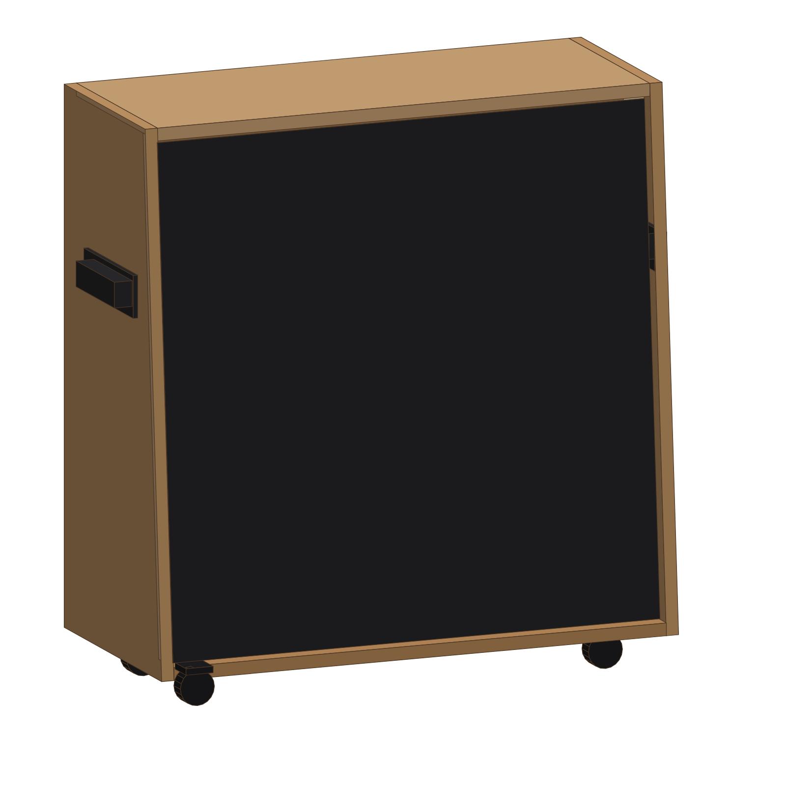
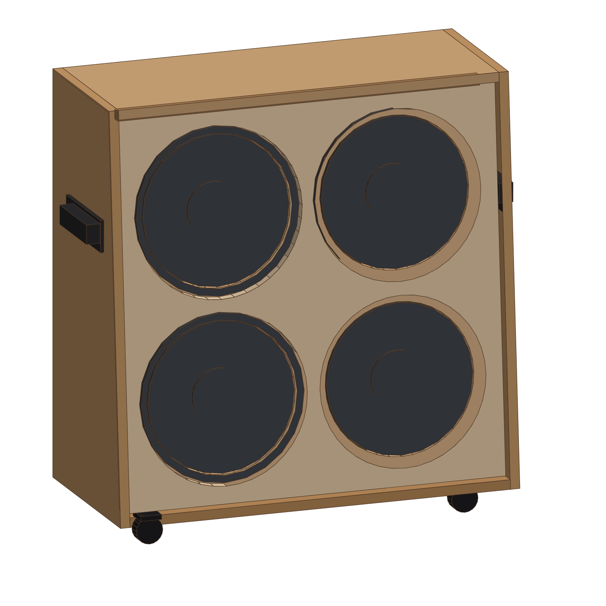
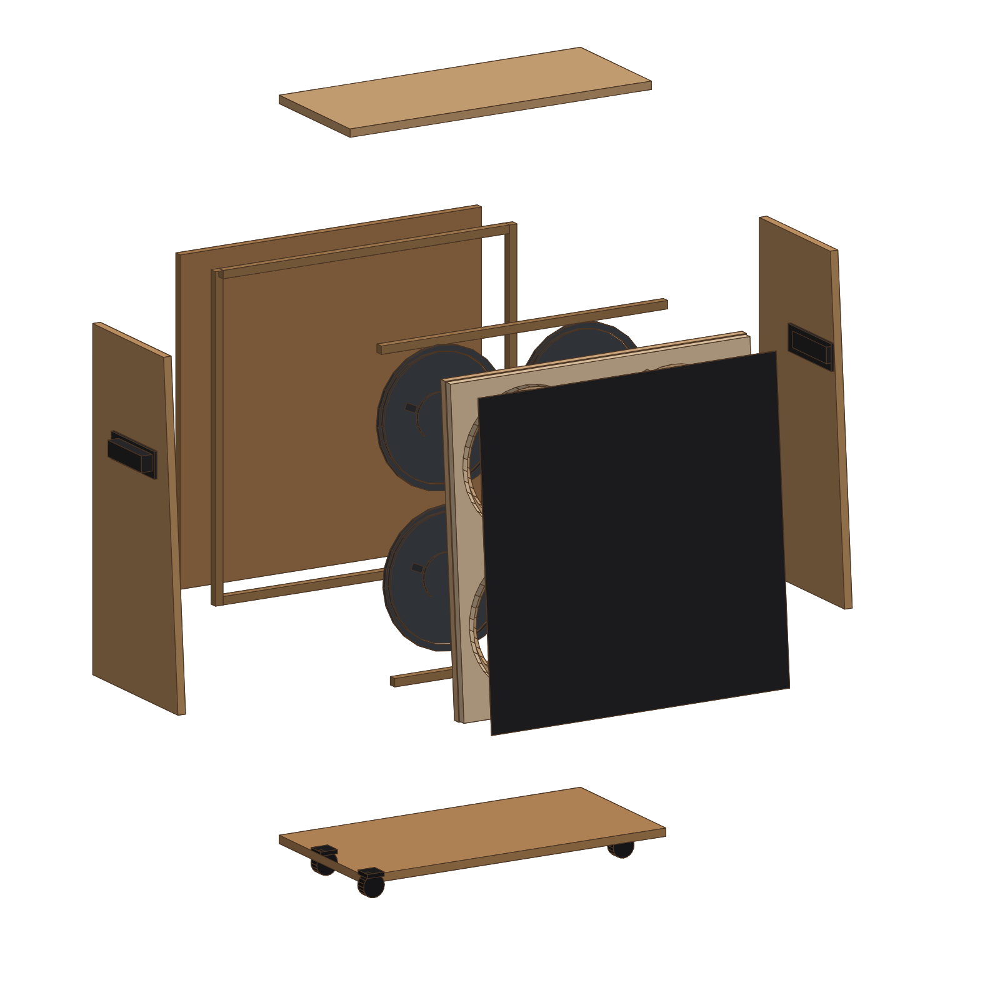
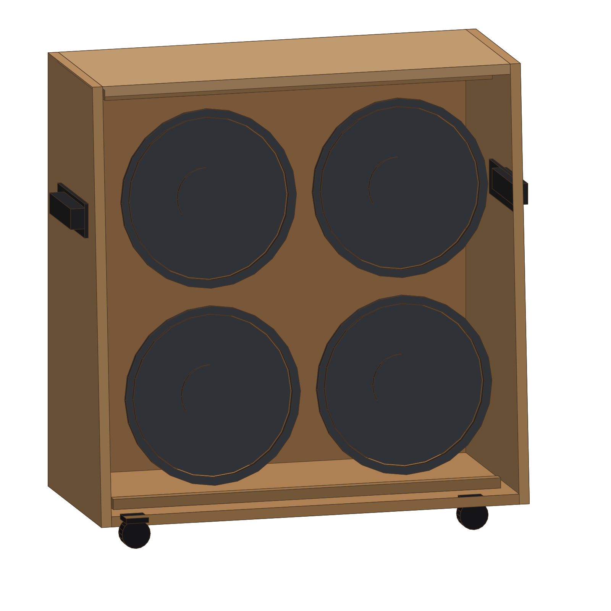

# 412 吉他箱体 DIY 全套图纸（Marshall 1960A 风格 · 喷涂版）

> **760 × 760 × 355 的 4×12 斜面箱体**，18mm 桦木多层板，**R6 圆边倒角 + 黑色喷涂**，
> 磁吸可拆网罩，提手/脚轮齐全。全套 A3 施工图 + 参数化脚本 + 可交互 3D 模型，
> 木材（含开料）约 **¥700**，整箱辅料约 ¥1100~1300（不含喇叭）。

🌐 **在线预览**：<https://mmr0817.github.io/412-cabinet-diy/>
（浏览器里直接看 3D 模型、下载 PDF，不用装任何软件）



---

## 目录

- [1. 关键参数](#1-关键参数)
- [2. 预览图](#2-预览图)
- [3. 为什么用"喷涂"而不是"包皮"](#3-为什么用喷涂而不是包皮)
- [4. 预算（木材约 ¥700）](#4-预算木材约-700)
- [5. 采购清单](#5-采购清单)
- [6. 工具](#6-工具)
- [7. 圆边倒角工艺（R6）](#7-圆边倒角工艺r6)
- [8. 黑色喷涂工艺](#8-黑色喷涂工艺)
- [9. 网罩（磁吸可拆）](#9-网罩磁吸可拆)
- [10. 提手与脚轮](#10-提手与脚轮)
- [11. 施工总流程](#11-施工总流程)
- [12. 接线](#12-接线)
- [13. 避坑清单](#13-避坑清单)
- [14. 文件说明与复现](#14-文件说明与复现)
- [15. 许可](#15-许可)

---

## 1. 关键参数

| 项目 | 数值 | 说明 |
|---|---|---|
| 外形 宽 × 高 | 760 × 760 | 与 Marshall 1960A 一致 |
| 深度（底 / 顶） | 355 / 295 | 顶面内收 60，前脸后倾 |
| 前脸倾角 | **4.51°** | 上排喇叭自然朝上 |
| 板厚 | 18 | 桦木多层板（胶合板/海洋板） |
| 外棱圆角 | **R6** | 全部外露棱边，喷漆后手感圆润 |
| 内腔 | 724 × 724 × 224~282 | 净容积约 130 L |
| 喇叭中心 | X 210 / 550，Y 210 / 550 | 4×12，间距 340 |
| 喇叭开孔 | Ø283 | 螺丝圆 Ø297，8 × Ø6.5 |
| 障板（平面尺寸） | 724 × 726.3 | 斜置后垂直占高 724 |
| 网罩框 | 720 × 722.3 | 开 4 × Ø316，磁吸 |
| 前唇（凹边） | 18 | 障板前退 36 − 网罩框 18 |
| 提手 | 2 × 表面式拉手 | 中心距 152，离地 520 |
| 脚轮 | 4 × 2 寸 | 2 万向 + 2 定向，距边 80 |
| 整箱重量 | 约 45 kg（含喇叭） | |

---

## 2. 预览图

| 成品外观 | 结构爆炸 |
|---|---|
|  |  |

| 网罩装上的样子 | 拿掉障板的内部 |
|---|---|
|  |  |

> 图片由 `生成脚本/build.py` 自动渲染，改参数后会自动更新。

---

## 3. 为什么用"喷涂"而不是"包皮"

| | 包皮（Tolex） | **喷涂（本方案）** |
|---|---|---|
| 材料成本 | 2.6 m² 约 120~200 元 | 底漆+面漆约 100~150 元 |
| 工时 | 高（裁切、刷胶、包角、收口） | 中（批灰、打磨、喷） |
| 棱边处理 | 必须 R10 以上大圆角才能包住 | **R6 就够**，工艺简单 |
| 外观 | 复古、接近原厂 | 现代哑光黑，像 Mesa/Orange |
| 修补 | 破了要整块换 | 砂纸打磨后补喷即可 |
| 掉落磕碰 | 不易留痕 | 会掉漆（可补） |
| 对新手 | 第一块皮 90% 会翻车 | 容错率高 |

**本方案的关键设计**：因为不包皮，所以外棱做 **R6 圆角**；
但**前唇 18mm 的凹边保留直角**，喷黑后形成一圈自然阴影线，
网罩扣上去有立体感，也方便定位（详见图纸 08 / 09）。

---

## 4. 预算（木材约 ¥700）

| 项目 | 数量 | 单价 | 小计 |
|---|---|---|---|
| 18mm 桦木多层板 1220×2440 | 2 张 | 260~320 | **520~640** |
| 板材开料 + 侧板斜切 | 1 单 | 50~80 | **50~80** |
| 原子灰 + 砂纸（80/180/320/600） | 1 套 | 40 | 40 |
| 环氧封闭底漆 | 1 kg | 40 | 40 |
| 黑色哑光/纹理面漆 | 1~1.5 kg | 60~110 | 60~110 |
| 哑光罩光漆（可选） | 0.5 kg | 30 | 30 |
| 提手（中心距 152） | 2 个 | 20 | 40 |
| 2 寸脚轮 | 4 个 | 15 | 60 |
| T 型螺母 + 木螺丝 + 胶 | — | — | 110 |
| 喇叭网布 1×1 m | 1 | 40 | 40 |
| 钕磁铁 Ø10×3 + 铁片 | 8 套 | — | 25 |
| 插孔板 + 喇叭线 | 1 套 | — | 45 |
| 包角（可选） | 8 个 | — | 40 |
| **合计（不含喇叭）** | | | **约 ¥1100~1300** |

> 喇叭另计：4 只 12 寸（8Ω/16Ω 同型号），国产 200 元/只起，进口 400~800 元/只。
> 对比：正品 Marshall 1960A 现价约 ¥5000+。

---

## 5. 采购清单

### 5.1 木料（图纸 06）

| # | 名称 | 数量 | 尺寸 (mm) | 备注 |
|---|---|---|---|---|
| 1 | 侧板 | 2 | 760 × 355（底）/ 295（顶）梯形 | 前边斜切 4.51° |
| 2 | 顶板 | 1 | 724 × 295 | 前口倒 1.4mm 斜口 |
| 3 | 底板 | 1 | 724 × 355 | |
| 4 | 后板 | 1 | 724 × 724 | 开插孔板孔 |
| 5 | 喇叭障板 | 1 | 724 × 726.3 | 自开 4×Ø283 + 32×Ø6.5 + 2×Ø10 |
| 6 | 网罩框 | 1 | 720 × 722.3 | 自开 4×Ø316 + 8 个磁铁坑 |
| 7-9 | 托条 | 6 根 | 18×18×688 ×4、18×18×724 ×2 | 边角料开条 |

**净用料约 2.6 m²**，但 5 块大板都是 724 宽，单张 1220×2440 排不下 → **买 2 张**。

> 下单话术（直接复制给商家）：
> 「18mm 桦木多层板（E0 级），按尺寸开料，公差 ±1mm。
> 侧板 2 件为梯形：高 760，底边 355，顶边 295，前边斜切 4.5°。
> 其余为矩形，四角 90°。**不要开任何孔**。」

### 5.2 五金 / 涂料 / 网罩

| 品名 | 数量 | 规格建议 |
|---|---|---|
| 12 寸喇叭 | 4 只 | 8Ω 或 16Ω，四只同型号 |
| 喇叭螺丝 + T 母 | 32 套 | M5×25 内六角 + M5 T 型螺母 |
| 木螺丝 | 约 130 颗 | 4×35 沉头；4×50 装箱用 |
| 白乳胶 | 1 kg | 组装 |
| 密封胶 | 1 支 | 中性硅酮/聚氨酯（**必须**） |
| 原子灰 | 1 罐 | 汽车原子灰，快干型 |
| 砂纸 | 各若干 | 80 / 180 / 320 / 600 目 |
| 环氧/硝基封闭底漆 | 1 kg | 封住木材吸水 |
| 黑色哑光聚氨酯面漆 | 1~1.5 kg | 双组份；或哑光自喷漆 8 罐 |
| 哑光粉/滑石粉（选配） | 少量 | 做出细砂纹 |
| 提手 | 2 个 | 表面式金属拉手，中心距 152 |
| 脚轮 | 4 个 | 2 寸，2 万向 + 2 定向，M8 螺纹 |
| 钕磁铁 | 8 个 | Ø10×3，N35 以上 |
| 铁螺丝 | 8 个 | M4×10 平头，作为磁吸对位 |
| 喇叭网布 | 1×1 m | Marshall 黑白编织布 |
| 插孔板 | 1 套 | 后置双 1/4" 插孔 |

---

## 6. 工具

- **必备**：电钻、曲线锯、**修边机 + R6 圆底刀**、木工夹 4 个、直角尺、砂纸/砂块、美工刀、口罩
- **强烈建议**：圆规式开孔器（或修边机 + 自制圆规靠模，开 Ø283）、沉头钻、喷枪/喷罐、热风枪
- **可选**：台锯或圆锯 + 靠山（切侧板斜边）、饼干榫机

> 开 Ø283 最省事的办法：让商家 CNC 开（加钱可做），
> 或电钻打穿心孔 + 曲线锯，再用砂鼓修圆。

---

## 7. 圆边倒角工艺（R6）

> 图纸 09 详图 a 给了 1:1 剖面。

**为什么要圆角**：喷漆箱体如果棱边是尖的，磕一下就掉漆，而且手感廉价。
R6 圆角让棱边有一层较厚的漆膜，耐磨、手感像成品箱。

**做法**

1. **顺序很重要**：组装 → 开喇叭孔/五金孔 → **倒角** → 批灰。
   倒角放在组装之后，长边才能一刀走通，不会在接缝处"接刀"。
2. 工具：修边机 + **R6 圆底刀**（1/4" 柄），或用 R6 圆角刨手工推。
   刀要新的、锋利，走刀速度慢一半，避免桦木表层的木皮撕裂。
3. **8 个箱角**是三面交汇，最考手：
   - 走到角上时轻抬收刀，留 3~5mm；
   - 换小刀或直接用砂纸（120 目包木块）把三个方向的圆角过渡顺；
   - 不要硬拐，硬拐一定崩边。
4. **前唇不要倒角**！障板凹陷处 18mm 的直角边保持锐利，
   否则网罩扣上去会露缝（图纸 09 特别标注了）。
5. 倒完用 180 目轻磨一遍，把刀痕磨顺，但**不要磨掉 R 形**。
6. 内角、喇叭孔边缘不倒角；喇叭孔边缘可用砂纸轻倒 0.5mm 去毛刺。

> 想要更圆润的手感可以用 R8~R10，但角部过渡更难，新手建议 R6。

---

## 8. 黑色喷涂工艺

> 图纸 09 详图 b 给了漆层结构。

**漆层结构（从里到外）**

```
18mm 桦木多层板
  ↓ 原子灰（填木纹、钉眼、接缝）
  ↓ 环氧封闭底漆（防吸水、增附着）
  ↓ 黑色哑光面漆 第 1 道
  ↓ 黑色哑光面漆 第 2 道（出膜）
```

**步骤**

1. **批灰**：原子灰薄刮 2 遍（不要一次厚刮）。
   第 1 遍填木纹和钉眼，干后 180 目磨；
   第 2 遍补砂眼和接缝，干后 320 目磨平。
2. **除尘**：用毛刷 + 气吹 + 微湿布，漆面起颗粒 90% 是灰没吹干净。
3. **底漆**：环氧或硝基封闭底漆 1~2 遍，薄喷，干后 320 目轻磨。
   这一步不能省：不封底，木材吸水会让面漆发花、起泡。
4. **面漆**：黑色哑光聚氨酯（双组份最好），2~3 遍。
   - 每遍薄喷，间隔 20~30 分钟（按说明书）；
   - 最后一道稍湿一点，让漆膜流平出光；
   - 喷罐的话：距离 25~30cm，走"Z"字，少量多次。
5. **做纹理（可选）**：想要 Marshall 那种细砂纹，
   面漆里加 3~5% 哑光粉/滑石粉；或用"喷点漆"在 40cm 外轻扫。
6. **固化**：完全固化 24~48 小时后再装喇叭、拧五金，
   否则螺丝和 T 母会把漆面挤裂。
7. **环境**：15~30℃、无风无尘、湿度 < 70%。
   阳台喷记得挡风；室内喷要做好通风和遮蔽。

**修补**：磕掉漆的地方用 600 目磨平 → 补一点面漆 → 干后 2000 目水砂 →
再薄喷一道，基本看不出来。

---

## 9. 网罩（磁吸可拆）

> 图纸 05 是网罩框，图纸 04 标了障板上的 8 个磁吸点。

**结构**：18mm 网罩框（开 4×Ø316）+ 网布 + 8 颗钕磁铁。
正面**没有任何螺丝**，喷涂后外观很干净，换布/清洁直接抠下来。

**做框**

1. 720 × 722.3 的板，比障板四周小 2mm，方便扣进去。
2. 开 4 个 Ø316 —— 必须比喇叭法兰 Ø310 大，且留 3mm 间隙，
   否则大音量时网布会碰到喇叭边，产生"噗噗"杂音。
3. 外沿做 R3 小圆角，喷同色漆，手感一致。

**装磁铁**

1. 在框**背面**（靠障板那一面）钻 8 个 Ø12 × 深 3.5 的浅坑；
2. 用环氧胶把 Ø10×3 钕磁铁粘进坑里，**磁极方向全部一致**；
3. 障板正面相同位置拧 8 个 M4×10 平头铁螺丝，作为磁吸对位；
4. 先试吸：手拉网罩应该能"啪"地吸住，垂直晃动不掉。
   吸力不够就换 N42/N52，或加一组磁铁。

**绷布**

1. 网布裁 760×760（四周各留 20mm）；
2. 从中心向外拉，先固定上下中点，再向四角拉；
3. 四边回包 15mm，白乳胶或喷胶固定，吹风机加热收边；
4. 布纹保持竖直，斜纹装上会显歪。

---

## 10. 提手与脚轮

**提手**（图纸 09 侧视）

- 表面式金属拉手，底板 180×60，中心距 152，装在两侧板外侧；
- 位置：距地 520mm，前后居中（z = 177.5）；
- 每侧钻 2 个 Ø6.5 通孔，M5 螺栓对穿 + 内侧大垫片，
  单侧承重按 30kg 算，两侧足够抬 45kg 的箱子。
- 不想打穿板？也可以选"背面带自攻钉"的拉手，但穿板更可靠。

**脚轮**（图纸 09 仰视）

- 4 个 2 寸轮：后侧 2 个万向，前侧 2 个定向（推着直走不跑偏）；
- 距边 80mm，M8 螺纹 + T 型母从内侧敲入底板的 18mm 板里；
- 底板 18mm 承 4 个轮没问题；想更稳可以加一块 12mm 的脚轮板。

> 在家用不经常搬动的话，只装 4 个橡胶脚垫也行（更省钱、不刮地板）。

---

## 11. 施工总流程

| 步骤 | 内容 | 要点 |
|---|---|---|
| 1 | 复核下料 | 量对角线，误差 < 2mm |
| 2 | 试装障板/网罩框 | 能顺滑放入，四周 0~2mm 缝 |
| 3 | 用喇叭实物核对螺孔 | 纸板做纸样比孔，**不能省** |
| 4 | 组箱体（侧板+顶板+底板） | 胶 + 4×50 螺丝，校对角线，胶干 4h |
| 5 | 粘后板托条 | 距后边 18mm |
| 6 | 装障板 + 前后托条 | 涂胶 + 内侧打密封胶 + 正面拧托条 |
| 7 | 装后板 | 泡棉条 + 螺丝，可拆 |
| 8 | **R6 倒角** | 组装后走刀，8 个角手工过渡 |
| 9 | **批灰 / 打磨 / 喷漆** | 见第 8 节，固化 24~48h |
| 10 | 装五金 | 提手 → 脚轮 → 插孔板 |
| 11 | 接线装喇叭 | 见第 12 节，注意相位 |
| 12 | 装网罩 | 粘磁铁 → 绷布 → 吸上去 |

> ⚠️ 顺序不能乱：**倒角必须在喷漆前**，**喷漆必须在装喇叭前**。

---

## 12. 接线

图纸 07 是完整接线图。要点：

- **4 只 16Ω**：上排并联 = 8Ω，下排并联 = 8Ω，两组串联 = **16Ω**
- **4 只 8Ω**：同样接法 = **8Ω**；4 只 4Ω → 4Ω
- ★ **相位必须一致**：四只喇叭的 "+" 接同一路（红线统一接 +）。
  接反会低频抵消、声音发虚，这是新手最常犯的错。
- 立体声改法：上排两只并联接 JACK A（8Ω），下排两只接 JACK B（8Ω）。

---

## 13. 避坑清单

| 症状 | 原因 | 预防 |
|---|---|---|
| 低频虚、发闷 | 箱体漏气 | 障板/后板接缝打胶；后板加泡棉条 |
| 大音量"嗡嗡"杂音 | 障板没夹紧 | 从正面拧托条把障板压死 |
| 网布"噗噗"响 | 网布贴到喇叭边 | Ø316 孔 + 3mm 间隙，布要绷紧 |
| 箱体扭斜 | 组箱没量对角线 | 误差 < 2mm，否则后面全歪 |
| 喇叭孔位偏 | 没按实物核对螺孔 | 纸板纸样比孔 |
| **倒角崩边** | 刀钝 / 走刀太快 / 逆纹 | 新刀、慢走、最后 3mm 手工过渡 |
| **喷漆起颗粒** | 灰尘 / 喷距太远 / 温度低 | 除尘、25cm 距离、15℃ 以上 |
| **漆面咬底/发花** | 没封底、木材吸水 | 必须做封闭底漆 |
| 螺丝把漆面挤裂 | 漆没固化就装配 | 固化 24~48h 再拧五金 |
| 磁吸不住 | 磁铁装反 / 吸力不够 | 磁极统一，换 N42/N52 |

---

## 14. 文件说明与复现

### 14.1 目录结构

```
412箱体计划/
├─ README.md                      本文件
├─ LICENSE                        许可
├─ 图纸/
│   ├─ 412箱体全套图纸.pdf         9 页 A3，直接打印
│   ├─ 01_总装三视图.svg
│   ├─ 02_侧板.svg
│   ├─ 03_顶板底板后板.svg
│   ├─ 04_喇叭障板.svg            开孔/打孔
│   ├─ 05_网罩框.svg              磁吸位
│   ├─ 06_下料清单与排板.svg       发给板材商家
│   ├─ 07_接线图与五金.svg
│   ├─ 08_纵剖面与节点详图.svg     装配关系
│   └─ 09_表面工艺与五金布置.svg   R6 圆角 / 喷涂 / 提手脚轮
├─ 3D模型/
│   └─ 412箱体_3D.html            双击打开，可旋转/分解/量尺寸
├─ images/                        README 预览图
├─ 数据/
│   ├─ 01_下料清单.csv
│   ├─ 02_五金采购清单.csv
│   ├─ 03_关键尺寸.csv
│   └─ 04_预算清单.csv
└─ 生成脚本/
    ├─ geom.py                     ★ 所有参数的源头
    ├─ drawings.py                 9 张图纸
    ├─ render3d.py                 轴测渲染
    ├─ svgtool.py                  SVG 绘图库
    ├─ viewer.js                   3D 查看器
    └─ build.py                    一键生成全部
```

### 14.2 打印图纸

1. 用 **A3 纸**，缩放选 **「实际大小 / 100%」**，不要选「适合页面」。
2. 验比例：图纸 01 上标注 **760** 的尺寸线，纸上应是 **152mm**（1:5）；
   图纸 02 的 760 应是 **190mm**（1:4）。对得上才能靠图下料。
3. `图纸/412箱体全套图纸.pdf` 已经按 A3 横向排好 9 页，直接送印最快。

### 14.3 重新生成

```bash
cd 生成脚本
python3 build.py
```

会重新生成：9 张 SVG、A3 打印页 + PDF、3D HTML、4 个 CSV、4 张预览 PNG。
只依赖 Python 标准库；PDF 和 PNG 需要本机装有 Chrome（可自动跳过）。

### 14.4 改尺寸

所有参数集中在 `生成脚本/geom.py` 顶部：

```python
W = 760.0        # 外形宽
H = 760.0        # 外形高
D = 355.0        # 底部（最大）深度
SLANT = 60.0     # 前脸倾斜量（顶面比底面窄多少）
T = 18.0         # 板厚
BAFFLE_OFF = 36  # 障板前退
GR_T = 18.0      # 网罩框厚
EDGE_R = 6.0     # 外棱圆角半径
HANDLE_Y = 520.0 # 提手高度
SPK_DX / SPK_DY  # 喇叭中心位置
```

改完重跑 `python3 build.py` 即可。做 1960B（直立款）就把 `SLANT = 0`。

### 14.5 3D 模型怎么看

双击 `3D模型/412箱体_3D.html`（Chrome / Edge / Safari）：

- **拖动**旋转，**滚轮**缩放；
- 「分解」滑杆拉到 100% 看内部结构与零件层次；
- 「显隐」可单独关掉网罩框 / 障板 / 喇叭 / 网布；
- 「尺寸标注」显示 760/760/355/斜收 60/4.51°；
- 左侧零件列表**鼠标悬停**会高亮。
- 也支持地址栏参数分享视角：`412箱体_3D.html#e=0.6&az=150&el=16`

> 模型是结构示意，不含漆膜、螺丝、包角等细节；尺寸以图纸为准。

---

## 15. 许可

- **图纸 / 文档**：CC BY-NC-SA 4.0（署名 · 非商业 · 相同方式共享）
- **脚本代码**：MIT

自己在家做、送朋友、发制作过程都随意；商用（量产销售）请先联系。

本设计参考 Marshall 1960A 的公开外形尺寸，结构做了便于手工复现的调整，
与 Marshall 公司无关，也不是原厂图纸。"Marshall" 是其商标，
自制箱体请勿使用原厂 LOGO 出售。


